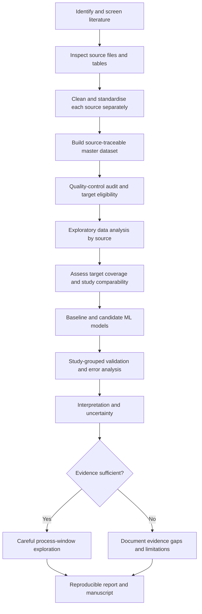

# Aluminium–Copper Laser Welding: Data-Driven Weld Quality Prediction

<p align="center">
  <strong>A traceable, literature-informed research workflow for analysing experimental Al–Cu laser-welding data and developing carefully validated weld-quality prediction models.</strong>
</p>

<p align="center">
  <a href="https://www.python.org/"></a>
  <a href="https://scikit-learn.org/"></a>
  <a href="LICENSE"></a>
  
</p>

---

## Project at a glance

**Research topic:** Data-Driven Prediction of Weld Quality in Aluminium–Copper Laser Welding.

This project builds a reproducible workflow around experimental data reported in published Al–Cu laser-welding studies. It focuses on preserving source provenance, standardising measured variables, auditing data quality, understanding differences between studies, and only then deciding whether predictive machine-learning models are scientifically defensible.

Aluminium and copper are difficult to join because of differences in melting behaviour, thermal conductivity, reflectivity and other thermophysical properties. Their interaction during laser welding can lead to unstable melt-pool behaviour, porosity, cracking, incomplete fusion and aluminium–copper intermetallic compounds (IMCs). Weld quality is therefore treated as multidimensional: geometry, mechanical behaviour, metallurgical features and electrical performance are distinct outcomes.

> **Current project status (16 November 2026):** Four source datasets have been assembled into an 84-record traceable master table. Data inspection, cleaning, master construction, quality control and source-aware EDA are complete. Initial source-specific ML evaluations are complete: wobble face bead width (29 records, 17 process conditions; Extra Trees pooled out-of-fold MAE 0.2830 mm, RMSE 0.3979 mm, R² 0.3457) and conventional weld bead width (21 eligible records, 7 process conditions; Extra Trees pooled out-of-fold MAE 0.0984 mm, RMSE 0.1372 mm, R² 0.7487). The conventional interface-width result is weak (R² 0.0972), and penetration-depth prediction is not supported (all tested pooled R² values are negative). Fold-level R² is unstable in both small datasets. These are preliminary within-source evaluations, not external validation. See `docs/INITIAL_WOBBLING_MODEL_RESULTS.md` and `docs/INITIAL_CONVENTIONAL_MODEL_RESULTS.md`.

## Current data inventory

The current master dataset contains 84 records from four source groups:

| Source group | Records | Current content |
|---|---:|---|
| Conventional Al–Cu laser welding | 27 | 9 process combinations, 3 repeats each; bead width, interface width and penetration depth |
| Al–Cu wobble laser welding | 36 | 18 process combinations, 2 repeats each; wobble settings, bead-width measures and penetration depth |
| Shin et al. (2021) | 11 | Matched measured outcomes: tensile shear strength, electrical resistance and welding area |
| Lee et al. (2022) | 10 | Reported force values and fracture-location descriptions, with source-table inconsistencies flagged |
| **Total** | **84** | **Multiple studies and measurement systems; not one homogeneous modelling table** |

### Quality-control findings

The Notebook 06 audit of the exported QC dataset reported:

- 84 records and 45 columns in the QC master file.
- 0 duplicate master IDs, 0 duplicate source-record keys and 0 exact duplicate rows.
- 6 conventional records have all three geometry outputs equal to zero. They are retained in the master table and excluded from the default geometry-regression subsets pending physical interpretation.
- 7 wobble records have missing bead-width measurements: 6 are annotated “Specimen cut” and 1 has no stated reason. Missing values remain missing.
- 4 Lee 2022 force records are flagged for inconsistencies between reported minimum, maximum and/or average values. The force modelling subset is intentionally empty until the original table is verified.
- The categorical field previously named `fracture_area_reported` has been renamed `fracture_location_reported`; values such as Al, Cu and Joint describe fracture location, not a numeric area.

These are audit observations, not proof that every other measurement is error-free. Always preserve the original publication and check its tables before publication or modelling.

## Research objectives

1. Assemble experimental Al–Cu laser-welding data with traceable publication and record identifiers.
2. Describe how reported laser and joint parameters relate to measured weld outcomes within each source.
3. Identify which targets have enough reliable observations and compatible definitions for modelling.
4. Establish transparent baselines and compare suitable regression models.
5. Evaluate generalisation across studies using study-grouped validation where the number of independent studies permits it.
6. Interpret model behaviour cautiously and distinguish statistical association from physical causation.

## Research workflow



## Notebooks and execution order

Run the notebooks in order. The Colab links open the notebooks from the repository; sign in to Colab with the Google account you intend to use before opening them.

| Notebook | Purpose | Link |
|---|---|---|
| 01 | Inspect original data files and workbook structure | [Open in Colab](https://colab.research.google.com/github/aadhilahamath07-pixel/AlCu-Laser-Welding-ML/blob/main/notebooks/01_data_inspection.ipynb) |
| 02 | Clean and standardise conventional welding data | [Open in Colab](https://colab.research.google.com/github/aadhilahamath07-pixel/AlCu-Laser-Welding-ML/blob/main/notebooks/02_conventional_data_cleaning.ipynb) |
| 03 | Build the conventional dataset | [Open in Colab](https://colab.research.google.com/github/aadhilahamath07-pixel/AlCu-Laser-Welding-ML/blob/main/notebooks/03_build_conventional_dataset.ipynb) |
| 04 | Build the wobble-welding dataset | [Open in Colab](https://colab.research.google.com/github/aadhilahamath07-pixel/AlCu-Laser-Welding-ML/blob/main/notebooks/04_build_wobbling_dataset.ipynb) |
| 05 | Combine source records into a traceable master dataset | [Open in Colab](https://colab.research.google.com/github/aadhilahamath07-pixel/AlCu-Laser-Welding-ML/blob/main/notebooks/05_build_master_experimental_dataset.ipynb) |
| 06 | Audit the master dataset and create target-specific eligibility subsets | [Open in Colab](https://colab.research.google.com/github/aadhilahamath07-pixel/AlCu-Laser-Welding-ML/blob/main/notebooks/06_master_dataset_quality_control.ipynb) |
| 07 | Explore source-specific distributions, eligibility-aware correlations, target-value concentration and export the wobble ML subset | [Open in Colab](https://colab.research.google.com/github/aadhilahamath07-pixel/AlCu-Laser-Welding-ML/blob/main/notebooks/07_exploratory_data_analysis.ipynb) |
| 08 | Evaluate the Notebook 07 wobble subset with grouped cross-validation, fold diagnostics and out-of-fold plots | [Open in Colab](https://colab.research.google.com/github/aadhilahamath07-pixel/AlCu-Laser-Welding-ML/blob/main/notebooks/08_grouped_ml_evaluation.ipynb) |
| 09 | Evaluate conventional bead width, interface width and penetration depth with leave-one-process-condition-out validation | [Open in Colab](https://colab.research.google.com/github/aadhilahamath07-pixel/AlCu-Laser-Welding-ML/blob/main/notebooks/09_conventional_grouped_ml_evaluation.ipynb) |

Notebook outputs are generated in the Colab runtime and downloaded when instructed. They are not automatically committed to GitHub. Store approved, documented outputs in the appropriate repository folder when ready.

## Candidate process inputs

The final features depend on what each paper actually reports. Candidate variables include:

- Laser power (W) and welding/travel speed (mm/s).
- Wobbling/tangential speed and wobbling diameter or amplitude.
- Beam offset, focus position, beam diameter and laser mode.
- Aluminium and copper grades, tempers and thicknesses.
- Upper-sheet material, joint type, overlap/gap and welding direction.
- Shielding gas, filler material and process environment.

A nominal line-energy descriptor may be calculated as (E_l=P/v) when power and travel speed are correctly defined and use compatible units. It is not absorbed heat input: absorptivity, beam distribution, interaction time and heat losses are not represented by this ratio. Derived variables must be checked for redundancy with their source variables.

## Candidate prediction targets

Targets are not interchangeable across papers. Examples include:

- **Geometry:** face/bead width, interface width, penetration depth and fusion-zone dimensions.
- **Mechanical:** tensile strength, tensile-shear strength, maximum load, elongation and fracture mode.
- **Metallurgical:** IMC thickness, phase information and microhardness.
- **Electrical:** joint resistance or resistivity with test conditions retained.
- **Defects:** porosity, cracks, lack of fusion and defect area/fraction.

A target should only be modelled when its definition, unit, test method and source coverage are sufficiently clear.

## Data integrity and modelling rules

1. Keep raw source files unchanged and preserve record-level provenance.
2. Preserve original values and units; document every conversion.
3. Never replace an unknown value with zero or silently impute missing measurements.
4. Retain questionable observations with explicit flags until their source meaning is resolved.
5. Do not pool conventional, wobble, Shin and Lee records just because some column names appear similar.
6. Treat repeated specimens and repeated process conditions appropriately; do not count replicates as independent studies.
7. Fit imputers, scalers, feature selection and other preprocessing inside each training fold.
8. Prefer validation grouped by publication/study to reduce leakage. If too few independent studies exist, report that limitation instead of claiming external generalisation.
9. Report MAE, RMSE and R² with target units, sample counts and split design. R² can be unstable or uninformative on very small test sets.
10. Feature importance and SHAP explain model associations; they do not prove physical causation.

## Repository structure

```text
AlCu-Laser-Welding-ML/
├── data/
│   ├── raw/                 # Original source-derived files
│   ├── processed/           # Standardised source-level data
│   ├── master/              # Consolidated master outputs
│   └── README.md            # Data dictionary, provenance and QC notes
├── notebooks/               # Ordered Colab/Jupyter workflow (01–09)
├── src/                     # Reusable Python functions (to be developed)
├── results/                  # Approved figures, tables and metrics (future)
├── requirements.txt
├── LICENSE
└── README.md
```

## Getting started locally

```bash
git clone https://github.com/aadhilahamath07-pixel/AlCu-Laser-Welding-ML.git
cd AlCu-Laser-Welding-ML
python -m venv .venv
```

Activate the environment, then install dependencies:

```bash
# Windows PowerShell
.venv\Scripts\Activate.ps1

# macOS / Linux
source .venv/bin/activate

pip install -r requirements.txt
```

Google Colab can also run the notebooks without a local installation.

## References currently represented in the dataset

- Shin et al. (2021), *Metals*, DOI: [10.3390/met11050831](https://doi.org/10.3390/met11050831).
- Lee et al. (2022), *Metals*, DOI: [10.3390/met12111957](https://doi.org/10.3390/met12111957).
- Additional conventional and wobble-welding source datasets are recorded in `data/raw/`; see the source workbook metadata and the data documentation before citing or redistributing them.

## GitHub repository About description

Suggested short description:

> Literature-derived experimental datasets and reproducible analysis for data-driven weld-quality research in aluminium–copper laser welding.

Suggested topics: `laser-welding`, `aluminium-copper`, `machine-learning`, `materials-science`, `weld-quality`, `data-analysis`.

The repository About description and topics are repository settings; update them in GitHub's **About → Edit repository details** panel if they are not already set.

## Responsible use, licensing and limitations

This is an academic research workflow, not a qualified welding procedure, industrial process-control system or certified engineering recommendation. The current dataset is small and heterogeneous. The initial wobble face-width result is preliminary and source-specific; it is not external validation, causal evidence or an optimum welding condition. Any future model must state its training domain, independent study count, uncertainty and limitations, and must be checked against physical experiments and relevant engineering standards.

The MIT License applies to original code in this repository. It does not grant permission to redistribute third-party papers, figures, tables or datasets. Check source-specific reuse terms before sharing extracted data.

The current modelling results are preliminary: the conventional analysis has only seven independent process conditions and the wobble analysis has 17. Fold-level R² is unstable, and neither experiment provides external validation across independent studies. The next priority is to verify flagged source records, expand comparable experimental data and improve metadata before final model selection or manuscript claims.

---

<p align="center">
  <strong>Materials Science × Laser Processing × Reproducible Data Science</strong>
</p>
